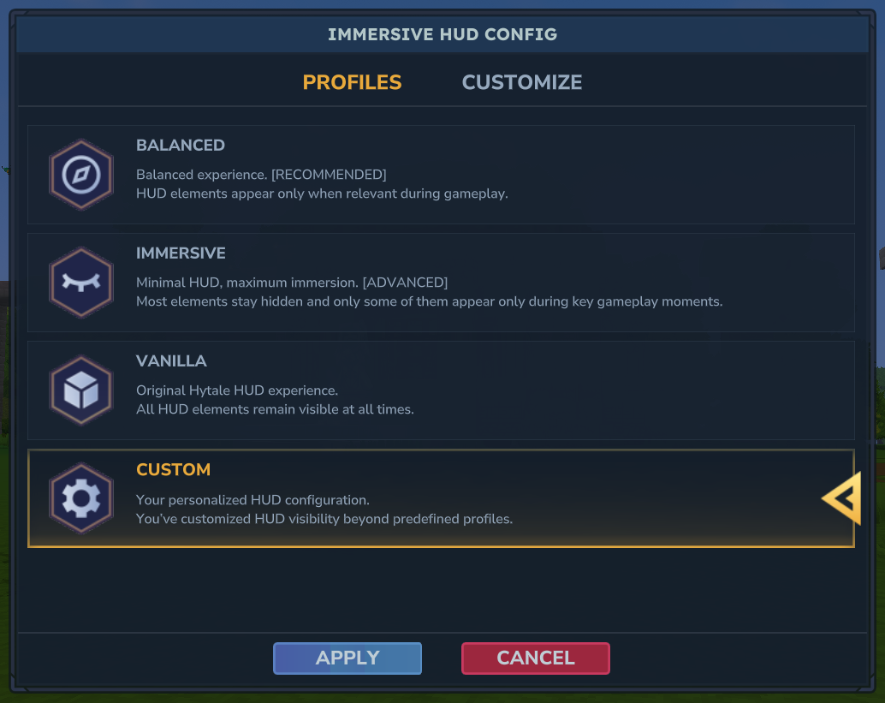
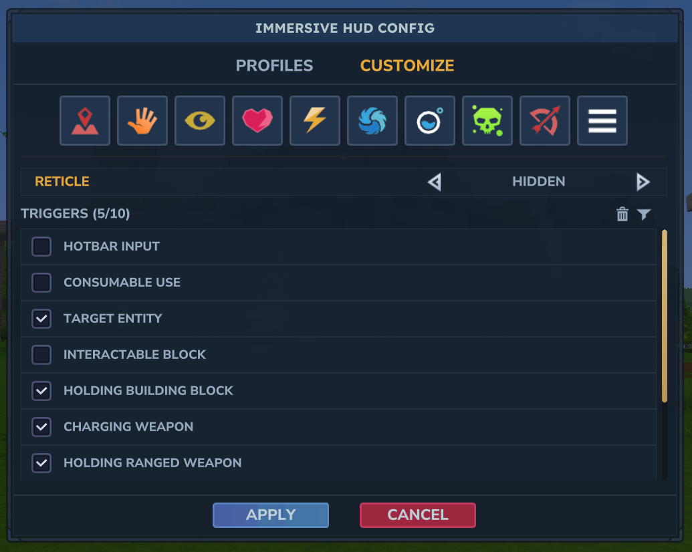
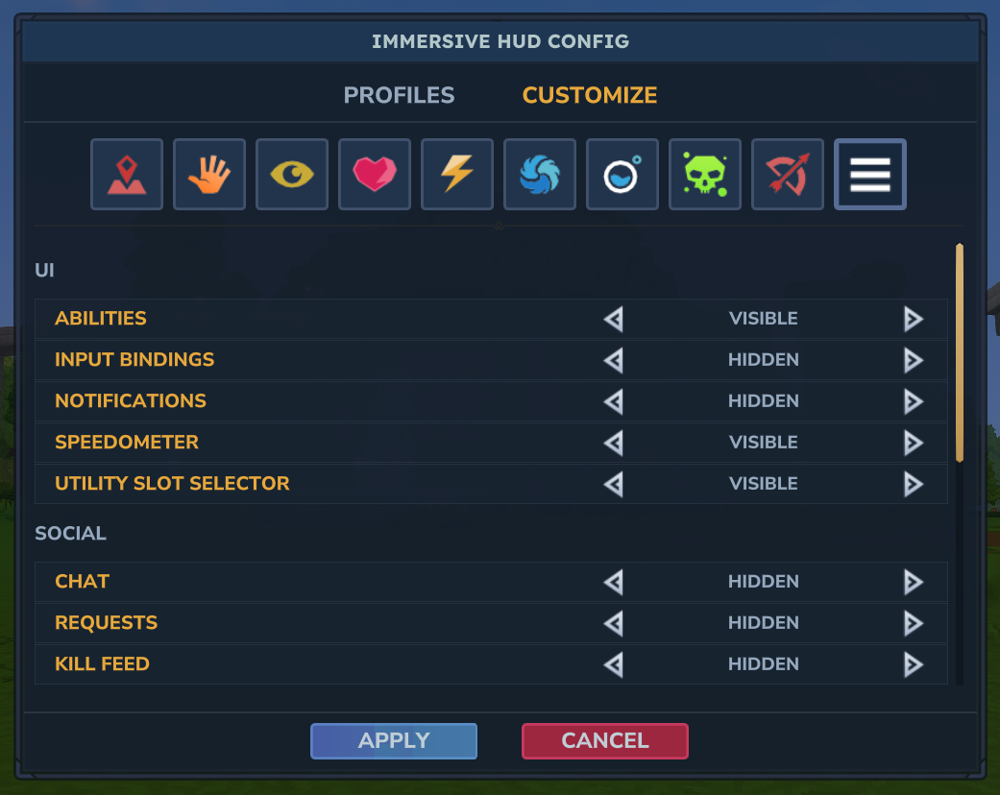

# Immersive HUD

<span style="color:orange">ImmersiveHUD</span> is a lightweight, fully configurable Hytale mod designed to reduce visual HUD noise without losing critical information.

Instead of disabling HUD elements, it makes them context-aware: they appear only when relevant and disappear when not needed.

It uses a flexible trigger system and ready-to-use profiles, making it quick and easy to customize the player experience.

It shows only what matters, when it matters, delivering a cleaner and more immersive experience.

By T0m.R4nD0m / [t0mr4nd0m@gmail.com](mailto:t0mr4nd0m@gmail.com)


---

## ✨ Features

- Dynamic HUD visibility based on gameplay
- Configurable triggers per component
- Built-in config profiles (balanced, immersive, vanilla)
- Per-player configuration
- Lightweight and performance-friendly
- Custom config UI, available in English and Spanish

---

## ⚡ Quick Start

Get <span style="color:orange">ImmersiveHUD</span> running in under a minute:

### 1. Install the mod

- **CurseForge App** : (recommended)
  - Install [CurseForge App](https://www.curseforge.com/download/app)
  - Search 'ImmersiveHud' mod and install it


- **Manually** :
  - Download the latest release `.jar` from the [Releases](https://github.com/t0mr4nd0m/hytale.immersivehud/releases) page
  - Place it in your Hytale\UserData\Mods folder

  >   Windows: %appdata%\Hytale\UserData\Mods

  >   Linux: ~/.local/share/Hytale/UserData/Mods

  >   macOS: ~/Library/Application Support/Hytale/UserData/Mods

### 2. Start Hytale
- Launch your Hytale and activate the mod

### 3. You're done
- The HUD will now dynamically hide or show based on gameplay actions and conditions. 

---

💡 Tip: Use command `/ihud config` or press crouching and map (CTRL + M by default) to customize your HUD configuration.

---

## 📖 How it works

ImmersiveHud combines two visibility models.

### 🅰️ Static visibility

A static HUD component is always hidden or visible.

Example: Input bindings, Notifications, Player list, Chat,...

---

### ️🅱️ Dynamic visibility

Dynamic HUD components are hidden by default and become visible when at least one rule matches the current gameplay context.

* Dynamic HUD component behaviour is defined by the dynamic rules assigned to it.
* Different rules can be applied to same component to react to different triggers.
* If no rules are assigned to the dynamic component, it will behave as a static component.

Examples:
- showing the hotbar when changing the slot selected
- showing health bar when damage is taken
- showing the reticle when looking at a workbench or aiming with a bow

---

## 📘 HUD Components

HUD components supported by ImmersiveHUD

| Component                                        | Group   | Type     | Default state | Default rules                                                                                   | Default Threshold |
|--------------------------------------------------|---------|----------|---------------|-------------------------------------------------------------------------------------------------|-------------------|
| <span style="color:orange">hotbar</span>         | Core    | Dynamic  | Hidden        | `HOTBAR_INPUT` `IN_COMBAT` | —                 |
| <span style="color:orange">compass</span>        | Core    | Dynamic  | Hidden        | `PLAYER_MOVING` `IN_COMBAT` | —                 |
| <span style="color:orange">reticle</span>        | Core    | Dynamic  | Hidden        | `CHARGING_WEAPON` `CONSUMABLE_USE` `TARGET_ENTITY` `INTERACTABLE_BLOCK` `HOLDING_BUILDING_BLOCK` `HOLDING_RANGED_WEAPON` `IN_COMBAT` | —                 |
| <span style="color:orange">health</span> 📊      | Bars    | Dynamic  | Hidden        | `HEALTH_NOT_FULL` `IN_COMBAT` | 100               |
| <span style="color:orange">stamina</span> 📊     | Bars    | Dynamic  | Hidden        | `STAMINA_NOT_FULL` `IN_COMBAT` | 100               |
| <span style="color:orange">mana</span> 📊        | Bars    | Dynamic  | Hidden        | `MANA_NOT_FULL` `IN_COMBAT` | 100               |
| <span style="color:orange">oxygen</span> 📊      | Bars    | Dynamic  | Hidden        | `OXYGEN_NOT_FULL`                                                                               | 100               |
| <span style="color:orange">statusicons</span> ⚠️| UI      | Dynamic  | Hidden        | `HOTBAR_INPUT` `IN_COMBAT` | —                 |
| <span style="color:orange">ammo</span>           | UI      | Dynamic  | Hidden        | `HOLDING_RANGED_WEAPON` `IN_COMBAT` | —                 |
| inputbindings                                    | UI      | Static   | Hidden        | —                                                                                               | —                 |
| abilities ✨                                     | UI      | Static   | Hidden        | —                                                                                               | —                 |
| notifications                                    | UI      | Static   | Hidden        | —                                                                                               | —                 |
| speedometer                                      | UI      | Static   | Visible       | —                                                                                               | —                 |
| utilityslotselector                              | UI      | Static   | Visible       | —                                                                                               | —                 |
| chat                                             | Social  | Static   | Visible       | —                                                                                               | —                 |
| requests                                         | Social  | Static   | Visible       | —                                                                                               | —                 |
| killfeed                                         | Social  | Static   | Visible       | —                                                                                               | —                 |
| playerlist                                       | Social  | Static   | Visible       | —                                                                                               | —                 |
| eventtitle                                       | Panels  | Static   | Visible       | —                                                                                               | —                 |
| objectivepanel                                   | Panels  | Static   | Visible       | —                                                                                               | —                 |
| portalpanel                                      | Panels  | Static   | Visible       | —                                                                                               | —                 |
| sleep                                            | Panels  | Static   | Visible       | —                                                                                               | —                 |
| blockvariantselector                             | Builder | Static   | Visible       | —                                                                                               | —                 |
| buildertoolslegend                               | Builder | Static   | Visible       | —                                                                                               | —                 |
| buildertoolsmaterialslotselector                 | Builder | Static   | Visible       | —                                                                                               | —                 |

✨ New hud component

📊 All components from `Bars` group support customizable threshold-based visibility [0-100]. If bar value is below the threshold the bar will be visible.

⚠️ This component is affected by some kind of issue in Hytale API. See `Know Issues` section for more details and possible workarounds

---

## 🏷️ Rules

Rules to define the visibility behaviour of dynamic HUD components

| Rule                     | Trigger condition                                                  |
|--------------------------|--------------------------------------------------------------------|
| `HOTBAR_INPUT`           | Player changes hotbar selection                                    |
| `CONSUMABLE_USE`         | Player is consuming food or potion                                 |
| `TARGET_ENTITY`          | Player is targeting an entity                                      |
| `INTERACTABLE_BLOCK`     | Player is looking at interactable blocks                           |
| `HOLDING_BUILDING_BLOCK` | Player is holding a placeable item or building block               |
| `PLAYER_MOVING`          | Player is moving                                                   |
| `PLAYER_WALKING`         | Player is walking                                                  |
| `PLAYER_RUNNING`         | Player is running                                                  |
| `PLAYER_SPRINTING`       | Player is sprinting                                                |
| `PLAYER_MOUNTING`        | Player is mounting                                                 |
| `PLAYER_FLYING`          | Player is flying                                                   |
| `PLAYER_GLIDING`         | Player is gliding                                                  |
| `PLAYER_JUMPING`         | Player is jumping                                                  |
| `PLAYER_CROUCHING`       | Player is crouching                                                |
| `PLAYER_CLIMBING`        | Player is climbing                                                 |
| `PLAYER_IN_FLUID`        | Player is in fluid                                                 |
| `PLAYER_ON_GROUND`       | Player is on ground                                                |
| `PLAYER_FALLING`         | Player is falling                                                  |
| `PLAYER_SITTING`         | Player is sitting                                                  |
| `PLAYER_ROLLING`         | Player is rolling                                                  |
| `CHARGING_WEAPON`        | Player is aiming or charging a weapon                              |
| `HOLDING_BUILDING_BLOCK` | Player is holding a building block or placeable item and crouching |
| `HOLDING_MELEE_WEAPON`   | Player is holding a melee weapon                                   |
| `HOLDING_RANGED_WEAPON`  | Player is holding a ranged weapon                                  |
| `BLOCKING_ATTACK`        | Player is using a weapon to block an attack                        |
| `IN_COMBAT`              | Player is engaged in combat with an hostile mob                    |
| `HEALTH_NOT_FULL`        | Health bar is not full                                             |
| `STAMINA_NOT_FULL`       | Stamina bar is not full                                            |
| `MANA_NOT_FULL`          | Mana bar is not full                                               |
| `OXYGEN_NOT_FULL`        | Oxygen bar is not full                                             |

---

💡 Tip: multiple rules can be combined to alter component behaviour. Ex. Hotbar rules=`HOTBAR_INPUT`, `CHARGING_WEAPON` -> when changes hotbar slot and when aiming.

---

When activating any rule bar `_NOT_FULL`, use `Threshold` to specify the bar level at which the component becomes visible.

Examples:
- Threshold = 100 → visible whenever the bar is not full
- Threshold = 50 → visible below half
- Threshold = 25 → visible only in critical situations

---

##  🎮 Profiles

Profiles provide predefined HUD configurations for different playstyles.  
You can switch between them instantly.

| Profile     | Description                                       |
|-------------|---------------------------------------------------|
| `Balanced`  | Shows HUD components when relevant                |
| `Immersive` | Minimal HUD, maximum immersion                    |
| `Vanilla`   | HUD always visible (vanilla-like)                 |
| `Custom`    | Custom profile defined by player                  |

---

## ⚙️ Configuration

To configure ImmersiveHud behaviour you can edit manually the player config file or even better use in-game **Config UI**

### Config UI

Use command `/ihud config` to open in-game configuration UI to manage visibility, rules and profiles interactively.

The configuration UI pauses private singleplayer games while open. Dedicated servers and games shared over LAN or with friends keep running. Closing the UI only releases a pause initiated by ImmersiveHUD.

1. Open the **PROFILES** tab and select one of the available profiles to start customizing your experience.
<p style="text-align:center;"></p>

2. Open the **CUSTOMIZE** tab to choose which HUD elements appear and configure the rules that determine when they are shown.
<p style="text-align:center;"></p>

<p style="text-align:center;"></p>

3. Finally, press **APPLY** to save and activate your configuration and start enjoying your new Immersive HUD experience.

---

ImmersiveHud uses two configuration layers:

1. Server configuration (Global)
2. Per-player configuration

---

### Global Configuration file - `config.json`

The global configuration file is created automatically when the mod is first loaded.

Server administrators can use this file to configure HUD detection, timing, and the configuration shortcut. 
`DefaultHudComponents` and `DefaultDynamicHud` define the initial HUD configuration for new players; changing them does not affect players who already have a saved configuration.

| Parameter | Description | Min | Max | Default |
| --- | --- | --- | --- | --- |
| `ConfigVersion` | ImmersiveHud mod version; updated automatically. | - | - | Installed mod version |
| `configShortcut.enabled` | Enable the configuration shortcut for all players. Set to `false` to disable it. | - | - | `true` |
| `configShortcut.modifier` | Required modifier action. Currently only `CROUCH` is supported. | - | - | `CROUCH` |
| `configShortcut.action` | Action used with crouch: `OPEN_MAP` or `OPEN_POCKET_CRAFTING`. | - | - | `OPEN_MAP` |
| `IntervalMs` | Time between HUD updates, in milliseconds. | `200` | `1000` | `250` |
| `HideDelayMs` | Initial wait before applying HUD visibility after the player becomes ready, and time a trigger keeps components visible after its condition ends, in milliseconds. Combat detection may extend trigger retention to bridge scans. | `0` | `3000` | `2000` |
| `ReticleTargetRange` | Maximum distance for detecting targeted entities and interactable blocks. | `1` | `24` | `8` |
| `CombatScanRange` | Maximum distance for detecting hostile NPCs during combat scans. | `1` | `24` | `8` |
| `PlayerCombatHorizontalFovDegrees` | Full horizontal field of view used to detect visible hostile NPCs, in degrees. Attacking NPCs targeting the player can be detected outside it. | `90` | `120` | `90` |
| `PlayerCombatVerticalFovDegrees` | Full vertical field of view used to detect visible hostile NPCs, in degrees. Attacking NPCs targeting the player can be detected outside it. | `45` | `70` | `70` |
| `LosNpcTargetHeight` | Height above the NPC position used as the target for combat line-of-sight checks. | `1` | `3` | `1` |
| `LosTargetEpsilon` | Distance subtracted from the line-of-sight ray length to avoid testing beyond the NPC target point. | `0` | `1` | `0.15` |
| `DefaultHudComponents` | Initial component visibility settings for new players. | - | - | Component catalog defaults (Balanced profile) |
| `DefaultDynamicHud` | Initial dynamic rules and bar thresholds for new players. | - | - | Component catalog defaults (Balanced profile) |

Numeric values outside the listed ranges are reset to their defaults when the configuration is loaded.

Configuration file path:

> **Windows**: %appdata%\Hytale\UserData\Saves\<world>\mods\TR_ImmersiveHud\config.json

> **Linux**: ~/.local/share/Hytale/UserData/Saves/<world>/mods/TR_ImmersiveHud/config.json

> **macOS**: ~/Library/Application Support/Hytale/UserData/Saves/<world>/mods/TR_ImmersiveHud/config.json

Example:

```json
{
  "ConfigVersion": "1.2.9",
  "configShortcut": {
    "enabled": true,
    "modifier": "CROUCH",
    "action": "OPEN_MAP"
  },
  "IntervalMs": 250,
  "HideDelayMs": 2000,
  "ReticleTargetRange": 8.0,
  "CombatScanRange": 8.0,
  "PlayerCombatHorizontalFovDegrees": 90.0,
  "PlayerCombatVerticalFovDegrees": 70.0,
  "LosNpcTargetHeight": 1.0,
  "LosTargetEpsilon": 0.15,
  "DefaultHudComponents": {
    "HideCompass": true,
    "HideHotbar": true,
    "HideReticle": true,
    "HideHealth": true,
    "HideStamina": true,
    "HideMana": true,
    "HideOxygen": true,
    "HideStatusicons": true,
    "HideAmmo": true,
    "HideAbilities": true,
    "HideInputbindings": true,
    "HideNotifications": true,
    "HideSpeedometer": false,
    "HideUtilityslotselector": false,
    "HideChat": false,
    "HideRequests": false,
    "HideKillfeed": false,
    "HidePlayerlist": false,
    "HideEventtitle": false,
    "HideObjectivepanel": false,
    "HidePortalpanel": false,
    "HideSleep": false,
    "HideBlockvariantselector": false,
    "HideBuildertoolslegend": false,
    "HideBuildertoolsmaterialslotselector": false
  },
  "DefaultDynamicHud": {
    "Compass": {
      "Rules": [
        "PLAYER_MOVING",
        "IN_COMBAT"
      ]
    },
    "Hotbar": {
      "Rules": [
        "HOTBAR_INPUT",
        "IN_COMBAT"
      ]
    },
    "Reticle": {
      "Rules": [
        "CONSUMABLE_USE",
        "TARGET_ENTITY",
        "INTERACTABLE_BLOCK",
        "HOLDING_BUILDING_BLOCK",
        "CHARGING_WEAPON",
        "HOLDING_RANGED_WEAPON",
        "IN_COMBAT"
      ]
    },
    "Health": {
      "Rules": [
        "IN_COMBAT",
        "HEALTH_NOT_FULL"
      ],
      "Threshold": 100.0
    },
    "Stamina": {
      "Rules": [
        "IN_COMBAT",
        "STAMINA_NOT_FULL"
      ],
      "Threshold": 100.0
    },
    "Mana": {
      "Rules": [
        "IN_COMBAT",
        "MANA_NOT_FULL"
      ],
      "Threshold": 100.0
    },
    "Oxygen": {
      "Rules": [
        "OXYGEN_NOT_FULL"
      ],
      "Threshold": 100.0
    },
    "Statusicons": {
      "Rules": [
        "HOTBAR_INPUT",
        "IN_COMBAT"
      ]
    },
    "Ammo": {
      "Rules": [
        "HOLDING_RANGED_WEAPON",
        "IN_COMBAT"
      ]
    }
  }
}
```
---

### Player Configuration File - `<playerUuid>.json`

A player configuration file is created automatically when the player first joins with the mod enabled, using the server defaults.

Player configuration file path:

> **Windows**: %appdata%\Hytale\UserData\Saves\<world>\mods\TR_ImmersiveHud\players\<playerUuid>.json

> **Linux**: ~/.local/share/Hytale/UserData/Saves/<world>/mods/TR_ImmersiveHud/players/<playerUuid>.json

> **macOS**: ~/Library/Application Support/Hytale/UserData/Saves/<world>/mods/TR_ImmersiveHud/players/<playerUuid>.json

Player configurations:
- override the server defaults
- are saved automatically

#### Example player configuration file:

Name: _d79b674a-9e8f-49a2-b7b0-8adf427df179.json_

```json
{
  "HudComponents": {
    "HideCompass": true,
    "HideHotbar": true,
    "HideReticle": true,
    "HideHealth": true,
    "HideStamina": true,
    "HideMana": true,
    "HideOxygen": true,
    "HideStatusicons": true,
    "HideAmmo": true,
    "HideAbilities": true,
    "HideInputbindings": true,
    "HideNotifications": true,
    "HideSpeedometer": false,
    "HideUtilityslotselector": false,
    "HideChat": false,
    "HideRequests": false,
    "HideKillfeed": false,
    "HidePlayerlist": false,
    "HideEventtitle": false,
    "HideObjectivepanel": false,
    "HidePortalpanel": false,
    "HideSleep": false,
    "HideBlockvariantselector": false,
    "HideBuildertoolslegend": false,
    "HideBuildertoolsmaterialslotselector": false
  },
  "DynamicHud": {
    "Compass": {
      "Rules": [
        "PLAYER_MOVING",
        "IN_COMBAT"
      ]
    },
    "Hotbar": {
      "Rules": [
        "HOTBAR_INPUT",
        "IN_COMBAT"
      ]
    },
    "Reticle": {
      "Rules": [
        "CONSUMABLE_USE",
        "TARGET_ENTITY",
        "INTERACTABLE_BLOCK",
        "CHARGING_WEAPON",
        "HOLDING_RANGED_WEAPON",
        "IN_COMBAT"
      ]
    },
    "Health": {
      "Rules": [
        "IN_COMBAT",
        "HEALTH_NOT_FULL"
      ],
      "Threshold": 25.0
    },
    "Stamina": {
      "Rules": [
        "IN_COMBAT",
        "STAMINA_NOT_FULL"
      ],
      "Threshold": 10.0
    },
    "Mana": {
      "Rules": [
        "IN_COMBAT",
        "MANA_NOT_FULL"
      ],
      "Threshold": 100.0
    },
    "Oxygen": {
      "Rules": [
        "OXYGEN_NOT_FULL"
      ],
      "Threshold": 100.0
    },
    "Statusicons": {
      "Rules": [
        "HOTBAR_INPUT",
        "IN_COMBAT"
      ]
    },
    "Ammo": {
      "Rules": [
        "HOLDING_RANGED_WEAPON",
        "IN_COMBAT"
      ]
    }
  }
}
```

---

## 🛠️ Technical highlights
- Dynamic HUD visibility system based on rules and triggers
- Robust configuration system: auto-generated and self-healing configs
- Per-player configuration system
- Quick configuration profiles system
- Command-driven configuration control
- Lightweight event & packet-driven state tracking
- Clean and extensible design
- Custom Config UI

---

## 🔧 Building

Requirements:
- JDK 25
- Maven 3.9+
- Access to Hytale Maven repositories

Build the project using:
> mvn clean verify

Run the eight standalone regression suites with `mvn test`.
Plugin version and Hytale build are configured in `pom.xml`.
Maven filters `manifest.json` when copying resources.
Asset-pack settings are configured directly in `src/main/resources/manifest.json`. 
Import `pom.xml` to open the project in your IDE.

The build produces a shaded mod jar named:
> target/ImmersiveHud-1.2.9.jar

---

## 📁 Project Structure

```text
src/main/java/com/tom/immersivehudplugin/
├── commands/
│   ├── ConfigCmd.java
│   └── IHudCommands.java
├── config/
│   ├── ConfigJsonMapper.java
│   ├── ConfigSchemaValidator.java
│   ├── ConfigSupport.java
│   ├── DynamicHudConfig.java
│   ├── DynamicHudRuleConfig.java
│   ├── GlobalConfig.java
│   ├── GlobalConfigStore.java
│   ├── HudComponentsConfig.java
│   ├── PlayerConfig.java
│   ├── PlayerConfigService.java
│   └── PlayerConfigStore.java
├── hud/
│   ├── component/
│   │   ├── HudComponent.java
│   │   ├── HudComponentCatalog.java
│   │   └── HudComponentRegistry.java
│   └── trigger/
│       ├── HudBarState.java
│       ├── HudTrigger.java
│       └── HudTriggerContext.java
├── profiles/
│   ├── Profile.java
│   └── ProfilePresets.java
├── runtime/
│   ├── context/
│   │   ├── HudBarStateUpdater.java
│   │   ├── HudTriggerContextFactory.java
│   │   ├── PlayerTickContext.java
│   │   └── PlayerTickContextFactory.java
│   ├── signal/
│   │   ├── CombatScanView.java
│   │   ├── CombatSignalScanner.java
│   │   ├── CombatSignalTracker.java
│   │   ├── HeldItemSignalTracker.java
│   │   ├── HeldItemState.java
│   │   ├── HudSignalPipeline.java
│   │   ├── MovementSignalTracker.java
│   │   ├── ReticleSignalTracker.java
│   │   └── WeaponBehaviorClassifier.java
│   ├── visibility/
│   │   ├── HudDeltaApplier.java
│   │   ├── HudRuleEvaluator.java
│   │   └── HudVisibilityCoordinator.java
│   ├── DynamicHudCache.java
│   ├── HudDetectionPlan.java
│   ├── HudRuntimeService.java
│   ├── HudTickProcessor.java
│   ├── HudTimers.java
│   ├── PlayerHeldItemState.java
│   ├── PlayerHudState.java
│   └── PlayerSessionService.java
├── ui/
│   ├── HudConfigPauseController.java
│   ├── HudConfigPresenter.java
│   ├── HudConfigProfilesRenderer.java
│   ├── HudConfigUiService.java
│   ├── HudConfigUiSession.java
│   ├── HudConfigView.java
│   ├── HudConfigVisibilityRenderer.java
│   ├── IHudConfigPage.java
│   ├── VisibilityComponentSelectorRenderer.java
│   ├── VisibilityDynamicDetailRenderer.java
│   └── VisibilityStaticDetailRenderer.java
└── ImmersiveHudPlugin.java

src/main/resources/
├── Common/
│   └── UI/
│       └── Custom/
│           ├── Assets/  # UI icons and images
│           ├── Views/
│           │   ├── ProfileRow.ui
│           │   ├── ProfilesView.ui
│           │   ├── VisibilityComponentButton.ui
│           │   ├── VisibilityStaticHeader.ui
│           │   ├── VisibilityStaticRow.ui
│           │   ├── VisibilityTriggerRow.ui
│           │   └── VisibilityView.ui
│           └── IHudConfigPage.ui
├── Server/
│   └── Languages/
│       ├── en-US/
│       │   └── immersivehud.lang
│       └── es-ES/
│           └── immersivehud.lang
├── icon-256.png
└── manifest.json

src/test/java/com/tom/immersivehudplugin/
├── config/
│   ├── ConfigPersistenceTest.java
│   └── DynamicHudRuleConfigTest.java
├── profiles/
│   └── ProfilePresetsTest.java
├── runtime/
│   ├── signal/
│   │   ├── CombatScanTest.java
│   │   └── WeaponBehaviorClassifierTest.java
│   ├── HudDetectionPlanTest.java
│   └── HudTimersTest.java
└── ui/
    └── HudConfigPauseControllerTest.java
```

---

## 🐞 Known Issues

- [Status Icons cannot be hidden](https://github.com/t0mr4nd0m/hytale.immersivehud/issues/8)
- [Network Quality icon cannot be hidden](https://github.com/t0mr4nd0m/hytale.immersivehud/issues/9)

Check them in GitHub to look for workarounds or fixes.

---

## 🚧 Roadmap

Possible future improvements:
- Support for future Hytale Hud components
- Support for Hud components from other mods (IHUD API)
- Import / export custom config profiles

---

## 📢 Contributing

Contributions, suggestions and feedback are welcome.

If you find a bug or want to propose improvements:

1. Open an issue
2. Describe the problem or feature request
3. Include logs if applicable
